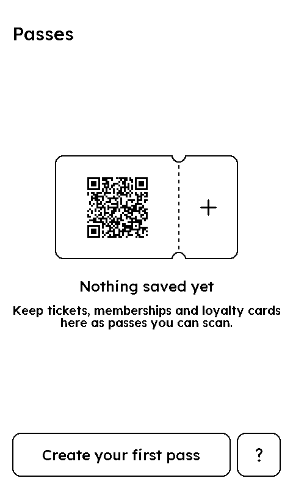
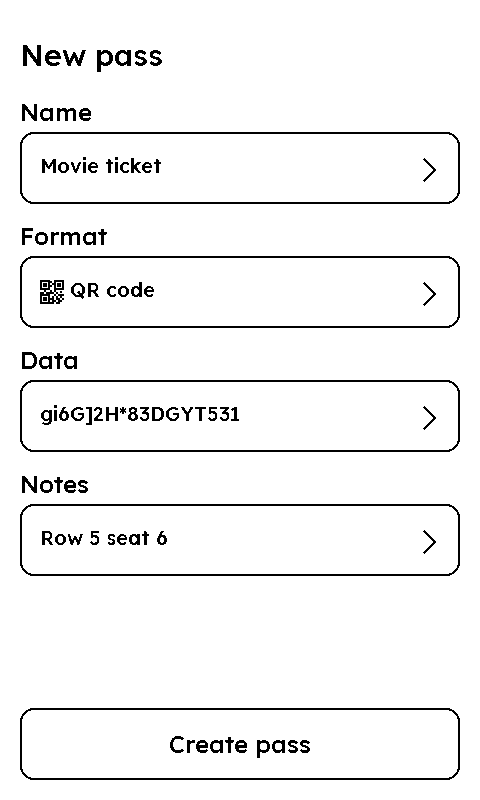
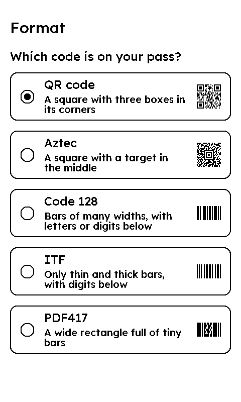
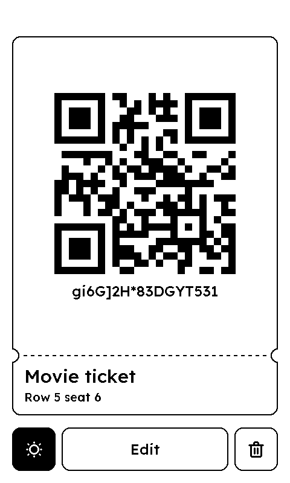
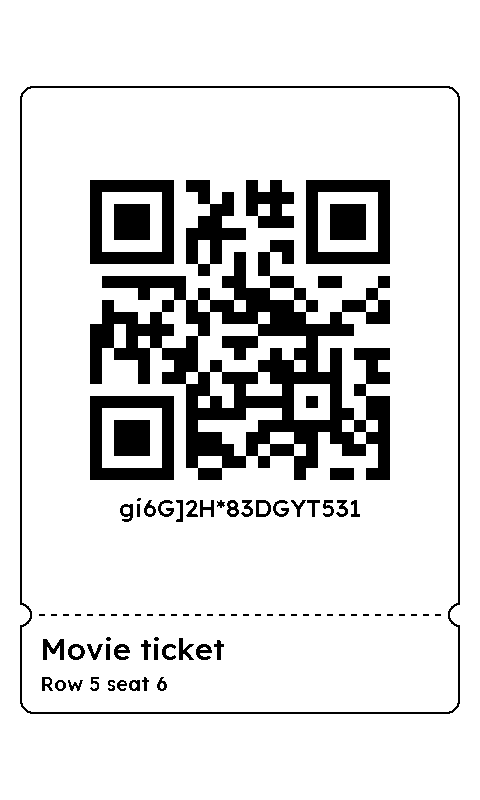

# Passes

Copy the code of a ticket, membership or loyalty card into Passes once, and your Xteink X4 e-reader shows it full screen whenever you need it: at a cinema entrance, a train gate, a gym desk or a library counter. No phone, no printout, and the e-ink screen stays readable in bright light.

|  |  |  |  |  |
| :---: | :---: | :---: | :---: | :---: |
| First launch | New pass | Choosing the format | A pass | On the lock screen |

## Features

- **Multiple formats**: QR code, Aztec, Code 128, ITF and PDF417.
- **Add notes**: a seat, a gate or a booking number, shown on the pass.
- **Scan anywhere**: swipe from one pass to the next.
- **Keep your most used pass on the lock screen**: ready to scan without unlocking the device.
- **Light up the code** (X4 Pro): turn the front light on for a scanner in a dim place.
- **Sort your list**: move passes up, down or to the top.
- **In your language**: 22 languages.
- **Compatible devices**: Xteink X4 Pro and X4 Classic.

## Install

Install Passes on your Xteink X4 Pro or X4 Classic from the XTEINK app on your phone ([iPhone](https://apps.apple.com/app/id6754496214), Android). The device needs a firmware that implements XTApp API 2.12 or later.

## Contributing

Bug reports, ideas and translations are welcome. See [CONTRIBUTING.md](CONTRIBUTING.md) to report a problem, change the code or release a version.

## Credits and license

Passes is released under the [MIT License](LICENSE). The Aztec, Code 128, ITF and PDF417 encoders (`src/lib_*.lua`) are Lua ports of [ZXing](https://github.com/zxing/zxing), including code ZXing derived from Barcode4J, and are licensed under the Apache License 2.0; each file lists its sources, changes and notices.
